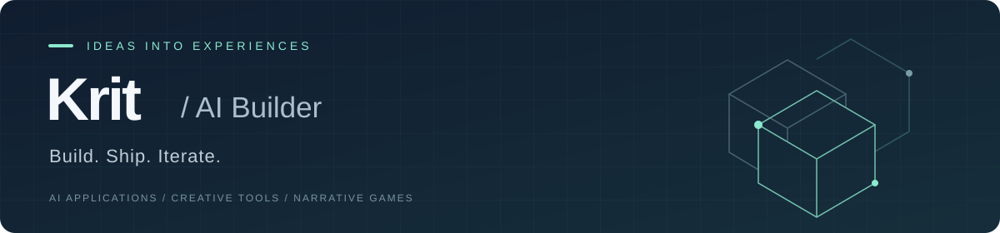

  

<h3 align="center">你好，我是 Krit 👋</h3>

  把想法做成可以体验的 AI 产品、创作工具与游戏。 
  AI applications · Creative tools · Narrative games

  <a href="https://tablercockett-byte.github.io/">个人网站 ↗</a>
  &nbsp; · &nbsp;
  <a href="mailto:mornoxborn89@gmail.com">联系我 ↗</a>
  &nbsp; · &nbsp;
  <a href="https://github.com/tablercockett-byte?tab=repositories">全部仓库 ↗</a>

## 精选项目 · Selected projects

从长期记忆对话，到 3D 素材生成，再到校园剧情游戏。点击图片或项目名即可进入仓库，查看预览、源码和运行说明。

<table>
  <tr>
    <td width="33%" valign="top">
      
      <h3><a href="https://github.com/tablercockett-byte/Xloun">01 / Xloun ↗</a></h3>
      
<strong>有长期记忆的 AI 角色对话</strong>

      
创建角色、持续对话，查看每轮回复引用的记忆；支持图片生成与 Docker 自托管。

      
<code>LLM</code> <code>RAG</code> <code>Next.js</code>

      
本地运行 / 自托管 · 需配置模型服务

      
<a href="https://github.com/tablercockett-byte/Xloun#readme"><strong>查看项目 →</strong></a>

    </td>
    <td width="33%" valign="top">
      
      <h3><a href="https://github.com/tablercockett-byte/assetforge-ai">02 / AssetForge AI ↗</a></h3>
      
<strong>从创意到 GLB 的 3D 工作台</strong>

      
从文字或参考图出发，完成概念图确认、AI 建模、在线预览、技术质检与模型导出。

      
<code>3D / GLB</code> <code>React</code> <code>FastAPI</code>

      
前后端原型 · 真实生成需配置供应商

      
<a href="https://github.com/tablercockett-byte/assetforge-ai#readme"><strong>查看项目 →</strong></a>

    </td>
    <td width="33%" valign="top">
      
      <h3><a href="https://github.com/tablercockett-byte/my-university">03 / 我的大学 ↗</a></h3>
      
<strong>由你的选择推动的大学生活</strong>

      
原创横版 2D 剧情生活模拟游戏。在四个学年里安排学习、兼职与人际关系，走向不同结局。

      
<code>剧情分支</code> <code>React</code> <code>TypeScript</code>

      
可本地游玩的内容原型 · AI 辅助创作

      
<a href="https://github.com/tablercockett-byte/my-university#readme"><strong>查看项目 →</strong></a>

    </td>
  </tr>
</table>

## 我在做什么

- **AI 产品实践**：探索 Agent、RAG 与自动化工作流，把模型能力接到具体使用场景中。
- **创作与交互**：尝试 AI 辅助的素材生产、游戏叙事与产品界面。
- **持续迭代**：从原型开始，完善首次体验、运行部署与使用说明，记录构建过程。

欢迎交流 AI 产品、创作工具与游戏项目，也关注 AI Builder / AI 产品相关机会。

---

  <strong>Build. Ship. Iterate.</strong> 
  先让它跑起来，再把体验做好。  
  <a href="mailto:mornoxborn89@gmail.com">mornoxborn89@gmail.com</a>

